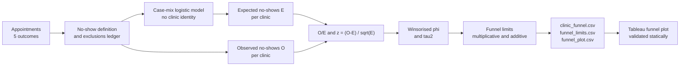

# noshowlimits

[](https://github.com/SlateGitOrg/noshowlimits/actions/workflows/ci.yml)


noshowlimits compares outpatient clinics on did-not-attend (no-show) rates after adjusting for case mix, and judges each clinic against funnel-plot control limits that are widened for overdispersion. A binomial GLM on appointment-level case mix gives each clinic an expected number of no-shows; observed over expected (O/E) is plotted against expected count with multiplicative and additive 95% and 99.8% limits. The results are exported as two CSVs and a generated Tableau workbook (`.twb`) that is validated statically against those CSVs. All data is synthetic, produced by a seeded generator with planted cases that the analysis has to recover.

## The problem

Operations analysts rank clinics by raw no-show rate and managers chase whoever is at the top. Raw rates punish clinics that see long-wait referrals and young adults. Small clinics reach the top by chance. Clinics with a real process problem, such as no reminder service, can sit unnoticed in the middle of the table. Reminders and overbooking then go to the wrong places.

The synthetic network has 42 clinics, 60,000 appointments over 18 months, and these planted cases:

| Clinic | Planted | What a correct analysis does |
|---|---|---|
| C07, C21 | +0.8 logit clinic effect (no reminder service), 2,800 appointments each | flag above the 99.8% limit |
| C40 | -1.0 logit clinic effect, 2,800 appointments | flag below the 99.8% limit |
| C12 | no clinic effect, but 70% long-lead referrals and 50% aged 18-29 | high raw rate, within limits |
| C33 | no clinic effect, 120 appointments, realised no-shows fixed at 15% | high raw rate, within limits |

## How it works



1. `metrics`: hospital cancellations and patient cancellations made 24 hours or more ahead are left out of numerator and denominator. Late patient cancellations (under 24 hours) are either no-shows or left out, by `--late-cancel noshow|exclude`. Every excluded appointment lands in a ledger by clinic and reason.
2. `riskmodel`: a statsmodels binomial GLM on lead-time band, age band, new vs follow-up and deprivation quintile. It never sees clinic identity. It reports coefficients, AUC by the rank formula and calibration by decile, and sums predicted probabilities into E per clinic.
3. `funnel`: z = (O - E) / sqrt(E). The overdispersion factor phi is the mean of z squared after clipping z to its 10th and 90th percentiles. Multiplicative limits are 1 +/- z_a sqrt(phi / E). Additive limits are 1 +/- z_a sqrt(1 / E + tau2), with tau2 = max(0, (I phi - (I - 1)) / (sum w - sum w^2 / sum w)) and w = E. Lower limits are floored at 0.
4. `export` and `tableau`: `clinic_funnel.csv` (one row per clinic), `funnel_limits.csv` (a grid of E with both limit pairs), `funnel_plot.csv` (the same limits and the clinic points as one long table) and `tableau/NoShowLimits.twb`, which is written from a field registry and checked by a static validator.

## Quick start

Python 3.11 or newer.

```bash
python -m venv .venv && . .venv/bin/activate
pip install -e ".[dev]"

noshowlimits generate                       # data/appointments.csv (60,000 rows, seed 2026)
noshowlimits fit                            # case-mix coefficients, AUC, decile calibration
noshowlimits funnel --method multiplicative # clinics outside the limits
noshowlimits funnel --method additive
noshowlimits league --raw --top 5 --include C40  # raw-rate league table, funnel status beside it
noshowlimits export                         # tableau/data/*.csv and tableau/NoShowLimits.twb
noshowlimits validate-twb                   # static check of the workbook against its CSVs

pytest -q
```

`funnel --phi 1.0` forces phi to 1 (plain Poisson limits) for comparison, and `--late-cancel noshow` counts late patient cancellations as no-shows in every command that reads the data.

To use the workbook, open `tableau/NoShowLimits.twb` in Tableau Desktop. The data connections are relative to the workbook (`tableau/data/`). The funnel plot sheet draws the limit lines and the clinic points from the single long table `funnel_plot.csv` on a synchronized dual axis: E on Columns, the limit values (Line marks, coloured by limit series) and the clinic O/E values (Circle marks, coloured by funnel status) on Rows. The `Limit Method` parameter switches the limits and statuses between multiplicative and additive.

## Example output

Every block below is the unedited output of the command shown, on the seeded data (`generate`, default seed). Rows are trimmed only where noted.

`noshowlimits league --raw --top 5 --include C40`, the five highest raw rates plus C40, with funnel status under both methods:

```text
overall no-show rate 0.1129   phi = 2.211   tau2 = 0.00902
Raw-rate league table
  raw rank   clinic   eligible     O       E   raw rate     O/E   status (mult)   status (add)
 ──────────────────────────────────────────────────────────────────────────────────────────────
         1   C21         2,437   539   269.2      0.221   2.002   above_99.8      above_99.8
         2   C07         2,440   508   279.4      0.208   1.818   above_99.8      above_99.8
         3   C12         1,286   218   230.4      0.170   0.946   within          within
         4   C20           999   151   117.1      0.151   1.290   above_95        above_95
         5   C33           106    16    12.7      0.151   1.259   within          within
        42   C40         2,462    97   261.6      0.039   0.371   below_99.8      below_99.8
```

C12 and C33 are third and fifth on raw rate and inside the limits under both methods. C07 and C21 are first and second and lie above the 99.8% limit. C40 is 42nd of 42 on raw rate (0.039, last row above) and falls below the 99.8% limit: the funnel says its low rate is more than case mix and chance explain.

`noshowlimits funnel --method multiplicative` and `--method additive`, every clinic outside the 95% limits:

```text
overall no-show rate 0.1129   phi = 2.211   tau2 = 0.00902
Funnel plot, multiplicative limits
  clinic     O       E     O/E      95% limits    99.8% limits   status
 ───────────────────────────────────────────────────────────────────────────
  C21      539   269.2   2.002   0.822 - 1.178   0.720 - 1.280   above_99.8
  C07      508   279.4   1.818   0.826 - 1.174   0.725 - 1.275   above_99.8
  C20      151   117.1   1.290   0.731 - 1.269   0.575 - 1.425   above_95
  C42      102   137.9   0.740   0.752 - 1.248   0.609 - 1.391   below_95
  C02      102   140.2   0.727   0.754 - 1.246   0.612 - 1.388   below_95
  C40       97   261.6   0.371   0.820 - 1.180   0.716 - 1.284   below_99.8
6 of 42 clinics listed
```

```text
overall no-show rate 0.1129   phi = 2.211   tau2 = 0.00902
Funnel plot, additive limits
  clinic     O       E     O/E      95% limits    99.8% limits   status
 ───────────────────────────────────────────────────────────────────────────
  C21      539   269.2   2.002   0.779 - 1.221   0.651 - 1.349   above_99.8
  C07      508   279.4   1.818   0.780 - 1.220   0.653 - 1.347   above_99.8
  C20      151   117.1   1.290   0.740 - 1.260   0.590 - 1.410   above_95
  C42      102   137.9   0.740   0.750 - 1.250   0.606 - 1.394   below_95
  C02      102   140.2   0.727   0.751 - 1.249   0.607 - 1.393   below_95
  C40       97   261.6   0.371   0.778 - 1.222   0.650 - 1.350   below_99.8
6 of 42 clinics listed
```

Both methods give the same six clinics and the same statuses here. With 42 clinics, about two are expected outside a 95% limit by chance alone. C20, C42 and C02 are outside the 95% limit but inside the 99.8% limit, so the 99.8% limit is what separates C07, C21 and C40. Forcing phi to 1 (`noshowlimits funnel --phi 1.0`) puts 13 of 42 clinics outside the 95% limits instead of 6, and C20 moves to `above_99.8`: without the overdispersion factor, ordinary between-clinic variation reads as a process problem.

`noshowlimits fit`, the case-mix model on 52,314 eligible appointments:

```text
Case-mix model (binomial GLM, n = 52,314, AUC = 0.622)

  term                        coef   std err   odds ratio
 ─────────────────────────────────────────────────────────
  const                     -2.303     0.048        0.100
  lead_band[2-6w]           -0.035     0.034        0.966
  lead_band[>6w]             0.661     0.034        1.936
  age_band[0-17]            -0.029     0.059        0.972
  age_band[18-29]            0.571     0.041        1.770
  age_band[50-64]            0.015     0.040        1.015
  age_band[65+]             -0.005     0.041        0.995
  appt_type[follow_up]      -0.211     0.029        0.810
  deprivation_quintile[1]    0.522     0.042        1.686
  deprivation_quintile[2]   -0.012     0.046        0.988
  deprivation_quintile[3]   -0.027     0.046        0.973
  deprivation_quintile[4]   -0.043     0.046        0.957

Calibration by decile of predicted risk

  decile       n   predicted   observed   |diff|
 ────────────────────────────────────────────────
       1   5,232      0.0703     0.0709   0.0006
       2   5,231      0.0722     0.0728   0.0007
       3   5,232      0.0737     0.0755   0.0018
       4   5,231      0.0810     0.0799   0.0011
       5   5,231      0.0883     0.0858   0.0024
       6   5,232      0.1074     0.1047   0.0027
       7   5,231      0.1229     0.1239   0.0010
       8   5,232      0.1357     0.1365   0.0007
       9   5,231      0.1517     0.1548   0.0032
      10   5,231      0.2257     0.2239   0.0018
```

The generating coefficients were 0.7 (lead time over 6 weeks), 0.6 (age 18-29), 0.5 (most deprived quintile) and -0.2 (follow-up); the fit recovers them to within 0.04. The AUC of 0.62 is low, as expected: case mix alone predicts little about any one appointment, and this model is used for expected counts, not for targeting patients.

## Design decisions

- **The model never sees clinic identity or clinic practices.** If clinic or reminder use were covariates, the model would absorb the very effect the funnel is meant to expose, and C07 and C21 would look average. The cost is a weaker model (AUC 0.62) and the assumption that every covariate that drives no-shows and differs between clinics is in the data. A missing case-mix variable shows up as clinic-level excess.
- **Overdispersion is estimated from winsorised z-scores.** Clipping z at its 10th and 90th percentiles stops the clinics under test from inflating the factor used to test them. The trade-off is that a network where more than about a fifth of clinics are genuinely off would have phi under-estimated. phi is used as estimated and is not floored at 1.
- **Both limit methods are exported.** Multiplicative limits scale the Poisson width by sqrt(phi) and stay wide at small E and tight at large E. Additive limits add a between-clinic variance tau2, so at large E they stop narrowing: at E around 270 the 95% half-width is 0.178 multiplicative and 0.221 additive. Additive is the more cautious call for big clinics; multiplicative is simpler to explain. The workbook switches between them with the `Limit Method` parameter, which filters `funnel_plot.csv` to the chosen method's rows.
- **Late patient cancellations are a switch, default excluded.** A cancellation under 24 hours is arguably a no-show in effect because the slot is rarely refilled, but it is still a patient decision with notice. Excluding them keeps the model's outcome a pure attended or did-not-attend question. Counting them as no-shows dilutes the case-mix coefficients, because late cancellations are unrelated to case mix in the generator (a test asserts this), and is available through `--late-cancel noshow`.
- **Lower limits are floored at 0.** A ratio cannot be negative, and at E below about 20 the 99.8% lower limit would otherwise be below zero on the plot. The Tableau formulas use `MAX(0, ...)` to match.
- **The funnel plot reads one long table.** Limit lines and clinic points are rows of `funnel_plot.csv` (series, method, E, value), so one datasource draws both and Tableau needs no data blending between a clinic file and a limit grid. The cost is some duplication: clinic rows appear once per method.
- **The workbook is checked without Tableau.** Tableau cannot run in CI, so `.twb` generation is driven by a field registry, and the validator confirms every declared column, calculated-field reference and worksheet field exists in the CSV headers and that captions and formulas equal the registry. It also checks sheet structure: one datasource per sheet, the mark type of each pane, no stacked measures on a shelf, and for the funnel plot two measures bound to two panes on a synchronized axis. A small evaluator for the Tableau formula subset used (`IIF`, `SQRT`, `MAX`, arithmetic, comparisons) runs each calculated field over the exported rows in tests and compares it with the Python values to 1e-9. The workbook has not been opened in Tableau Desktop in this repository's tests; the static checks cannot catch a rendering problem.

## Testing

```bash
pytest -q
ruff check . && ruff format --check .
```

The suite checks behaviour against known answers rather than only running the code:

- A 10-appointment hand fixture covering every outcome gives the hand-counted numerator and denominator under both late-cancellation settings, and the ledger accounts for every excluded appointment.
- phi on a 12-clinic fixture equals a value worked by hand, with winsorisation, to 1e-9. tau2 is checked against the moment formula and its zero floor.
- On the seeded data: lead-time and age coefficients are within 0.15 of 0.7 and 0.6; sum of E equals sum of O to 1e-6 relative; every calibration decile is within 2 percentage points; phi is above 1; C07 and C21 are above and C40 below the 99.8% limits under both methods; C33 and C12 are in the raw top five and within the 95% limits under both methods; forcing phi to 1 flags strictly more clinics.
- Limits narrow monotonically with E, and `funnel_limits.csv` evaluated at each clinic's E reproduces that clinic's limits to 1e-9.
- The Tableau workbook validates against its CSVs, equals what the registry builds, and fails with a message naming the field when a column, caption, formula, worksheet or dashboard zone is changed. The funnel sheet's structure is checked too: a stacked five-measure form, an unsynchronized or unbound axis, a wrong mark type or a missing filter each fail.

## Project layout

```text
src/noshowlimits/
  synth.py          seeded appointment generator with planted cases
  metrics.py        no-show definition, per-clinic counts, exclusions ledger
  riskmodel.py      binomial GLM, rank-formula AUC, decile calibration, expected counts
  funnel.py         O/E, winsorised phi, tau2, limits and status
  export.py         clinic_funnel.csv, funnel_limits.csv and funnel_plot.csv
  pipeline.py       analysis shared by the CLI, exporter and tests
  cli.py            generate, fit, funnel, league, export, validate-twb
  tableau/
    registry.py     fields, calculated fields, worksheets and dashboard
    build.py        writes the .twb from the registry
    validate.py     static validator
    formula.py      evaluator for the Tableau formula subset
tableau/
  NoShowLimits.twb  generated workbook
  data/             clinic_funnel.csv, funnel_limits.csv, funnel_plot.csv (committed)
tests/              pytest suite
.github/workflows/ci.yml
```

## License

MIT. See `LICENSE`.
